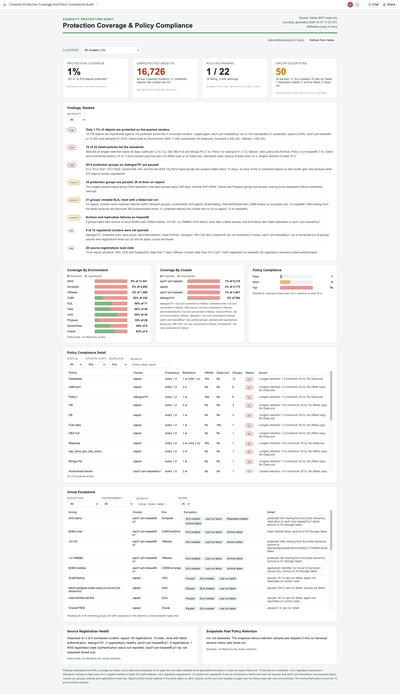

# Cohesity Protection Coverage & Policy Compliance Audit

**Author:** Akshay Kumar, Dir, Solutions Architecture ([akshay.kumar2@cohesity.com](mailto:akshay.kumar2@cohesity.com))

A Claude skill, also available as a Microsoft Copilot Studio agent, that audits your Cohesity protection posture from live Helios data and publishes it as a live, private Claude Artifact that refreshes every 4 hours: what is not protected, which policies miss your standards, which protection groups are paused or violating their SLA, and whether source registrations are healthy.

- Claude skill: [`claude/Cohesity-Protection-Coverage-Audit/SKILL.md`](claude/Cohesity-Protection-Coverage-Audit/SKILL.md) (the full page template is embedded in it)
- Output: one claude.ai **Artifact** titled `Cohesity Protection Coverage And Policy Compliance Audit` (no static HTML file)
- Refresh: scheduled task `cohesity-protection-coverage-refresh`, cron `0 */4 * * *`
- Data source: the **Helios MCP server** (`helios-mcp` connector). Everything is read-only.

## Two Versions

| | Claude skill | Microsoft Copilot Studio agent |
|---|---|---|
| Folder | [`claude/`](claude/Cohesity-Protection-Coverage-Audit/SKILL.md) | [`copilot-studio/`](copilot-studio/README.md) |
| Output | Live, private Claude Artifact, refreshed every 4 hours | Answers in chat, with tables, on demand |
| Helios access | `helios-mcp` connector, read-only | Helios MCP server added as a tool, read-only |
| Setup | Install the skill in Claude (see Install below) | Paste `instructions.md`, upload `knowledge/` files, add the Helios MCP tool |
| Screenshot | Below | Not applicable (chat answers) |

The sections below describe the Claude skill unless a heading says Copilot Studio.

## What you get

| Area | What it shows | Helios MCP tool |
|---|---|---|
| Cluster filter | Multi-select of all registered clusters; recalculates the KPIs, cluster coverage, policy table and exceptions in the browser | `dataprotect-get-clusters` |
| Table filters | Findings severity filter; policy table status, offsite, DataLock and search filters; exceptions table filtered by cluster, environment, exception type and search. Tables scroll with sticky headers. | none (client-side) |
| KPI cards | Protection coverage %, Unprotected objects, Policies passing, Group exceptions | `dataprotect-search-objects`, `dataprotect-get-protection-policies`, `dataprotect-get-protection-groups` |
| Ranked findings | 3 to 8 findings rated high / medium / low, written from the data (large unprotected populations, failing policies, long-paused groups, SLA violations, stale registrations, clusters that could not be queried) | all of the below |
| Coverage by environment | Protected vs unprotected objects per environment, Helios-wide | `dataprotect-search-objects` |
| Coverage by cluster | Protected vs unprotected per connected cluster | `dataprotect-search-objects` |
| Policy compliance | Pass / warn / fail split plus a detail table: frequency, retention, offsite copy, DataLock, groups using the policy, status, issues | `dataprotect-get-protection-policies` |
| Group exceptions | One row per group with chips for Paused (with age), SLA violated, Never run, Last run failed, **Replication stalled** and **Archive failed** (with "likely cause: replication stopped") | `dataprotect-get-protection-groups` |
| Protected but at risk | Per cluster, the number of protected objects whose last protection run failed (shown in the Unprotected KPI and as a tooltip on the cluster bars) | `dataprotect-search-objects` |
| Source registration health | Unhealthy or stale registrations per cluster | `dataprotect-get-source-registrations` |
| Snapshots past retention | Sampled check against each policy's longest retention | `dataprotect-get-object-snapshots` |

## Drill-down modes and what this replaces

Two narrow questions are answered in chat, without republishing the page:

- **Objects with no recent good backup**: give an object type, a cluster or name filter and a window (default 24 h); the skill checks each object's newest successful snapshot and returns hours since the last good snapshot, plus objects with no protection group. This is the function of `helios-coverage-check`.
- **Retention and replication of one protection group**: give a group name; the skill compares the policy's retention and replication targets with the last 10 runs and a sample of snapshots and reports snapshots past expiry and "likely cause: replication stopped". This is the function of `helios-retention-audit`.

Both are folded in so one skill owns "protection posture". What they gain: a published, refreshing page for the fleet-wide view, exact retention unit normalisation, de-duplicated registrations, and the page-level equivalents (the at-risk count and the replication / archive exceptions are computed for every cluster without per-object calls).

## Standards used (defaults)

The audit judges every policy against a baseline you can override in the request ("RPO 4 hours, keep 90 days"). The defaults are the skill's own baseline, **not** Cohesity or regulatory requirements, and the page footnote says so.

| Rule | Default | Result |
|---|---|---|
| Backup interval longer than `maxFreqHours` | 24 h (ProtectOnce policies exempt) | fail |
| Longest retention (base, extended or replication/archive copy) shorter than `minRetentionDays` | 30 days | fail |
| No offsite copy (no replication, archival, cloud vault, or `Archival` primary target) | | warn |
| No DataLock (WORM) on base retention | | warn |

Retention and schedule units come back mixed (Days, Weeks, Months, Years) whatever `durationUnit` says, so the skill normalises them (Weeks x 7, Months x 30, Years x 365).

## Requirements

- Claude desktop app (Cowork) with the **Helios MCP** connector (Controlled Availability: ask your Cohesity account team to enable it, then follow the Helios documentation topic *Helios MCP Server*).
- Artifacts and scheduled tasks available. Scheduled tasks run only while the Claude app is open.

## Install

1. Zip the folder `claude/Cohesity-Protection-Coverage-Audit` so `SKILL.md` is inside it.
2. Add it as a custom skill in Claude (Settings, Skills, upload) or copy it into your skills directory.
3. Confirm the Helios MCP connector is connected.

## Use

- "Run the Cohesity protection coverage audit"
- "Which of my policies fail a 90-day retention standard?"
- "What is unprotected in Helios and what should I fix first?"
- "Refresh the protection audit"

The first run publishes the artifact (about 60 Helios calls) and creates the 4-hour task. Later runs republish to the same URL. The page is private until you share it from its Share menu.

## How coverage is counted

`dataprotect-search-objects` returns a top-level `count` of matches even when you ask for one object, so coverage needs two calls per cluster or environment (`isProtected: true` and `false`), not paging through thousands of objects. Object counts include replicas of the same object on other clusters: the sum over clusters is larger than the sum over environments, which is Helios-wide. The page footnote states this.

## Notes from live testing

Validated on a lab Helios tenant on 2026-10-13 (12 clusters registered, 4 connected). The first run reported low coverage on that lab tenant, most policies failing a 30-day retention baseline and many paused or SLA-violating groups, plus one cluster whose group, policy and registration queries timed out. The skill now:

- shows a connected cluster whose group queries failed as **partial** (object counts kept, note displayed) instead of dropping it;
- dedupes source registrations by id (duplicates were returned) and applies a 24 h staleness rule only to auto-refreshing sources, 7 days for NAS, UDA and physical sources;
- builds exceptions as one row per group so the KPI counts groups, not rows;
- falls back to the last-modified time when a paused group has no `pauseMetadata`.

## Manual refresh

The page header has a **Refresh from Helios** button. A published page cannot call Helios on its own, so the button copies `Run the Cohesity-Protection-Coverage-Audit skill to refresh this report from live Helios data`; paste it into Claude to pull live data and republish the same artifact, then reopen or refresh the tab. The scheduled task (every 4 hours) and this command are the two refresh paths.

## If the artifact was deleted

If the stored artifact URL no longer exists, the skill republishes the page as a new artifact and says so in its reply, so a deleted page never blocks a refresh. Update the scheduled task prompt with the new link.

## When Helios is unreachable

If `helios-mcp` is down or its token has expired, a scheduled refresh does not clear the page. It keeps the last successful data and adds a red banner, "Unable to connect to Helios. Showing the last successful data.", under the header. The next successful refresh removes the banner.

## Known limits

- Object-level detail is deliberately not shown: only counts and names of clusters, groups and policies.
- Not-connected clusters cannot be queried and show as `n/a`.
- The snapshots-past-retention check is sampled and optional.

## Screenshots (Claude Version)



_Captured from the published artifact; cluster and group names are lab data._

## Microsoft Copilot Studio Version

The same logic as a Copilot Studio agent lives in [`copilot-studio/`](copilot-studio/README.md): `instructions.md` (agent instructions), `knowledge/` (two files to upload as Knowledge), `starters.md` (conversation starters) and step-by-step setup. It answers in chat and does not publish a page, schedule itself, or offer a cluster picker or CSV button. Add your Helios MCP server as a tool and enable only the read-only tools.

## Repository layout

```
Cohesity-Protection-Coverage-Audit/
  README.md
  claude/
    Cohesity-Protection-Coverage-Audit/SKILL.md      Claude skill (install this folder in Claude)
  copilot-studio/
    README.md          setup steps
    instructions.md    agent instructions
    knowledge/         files to upload as Knowledge
    starters.md        conversation starters
  docs/
    screenshots/protection-coverage-audit.png
```
