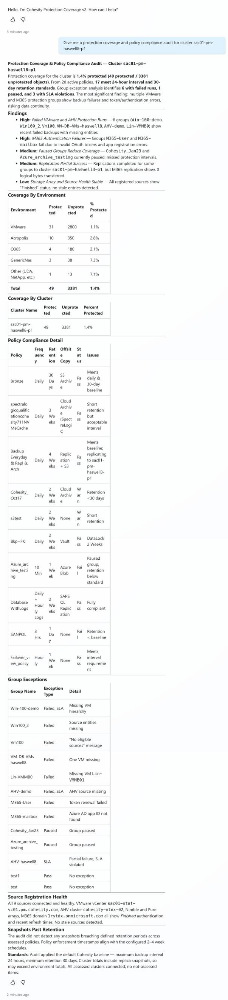

# Sample Output: Cohesity Protection Coverage Agent

Prompt: `Give me a protection coverage and policy compliance audit for cluster sac01-pm-haswell8-p1`

Model: GPT-5 Chat. Lab data. Captured in the Copilot Studio test pane in Light mode.

## Notes

| Topic | Note |
|---|---|
| Format | The answer is chat text with tables. The Claude skill gives a live, filterable page. See the screenshot in the main README. |
| Scope | Name one cluster for the fastest answer. |
| Standards | The defaults are a 24 hour backup interval and 30 days of retention. They are a baseline, not a regulatory requirement. |
| Accuracy | The agent follows the instructions but is a language model. Compare a few answers with Helios before you share the agent. |
| Your data | Cluster and group names in the image are lab data. Your answers will differ. |
